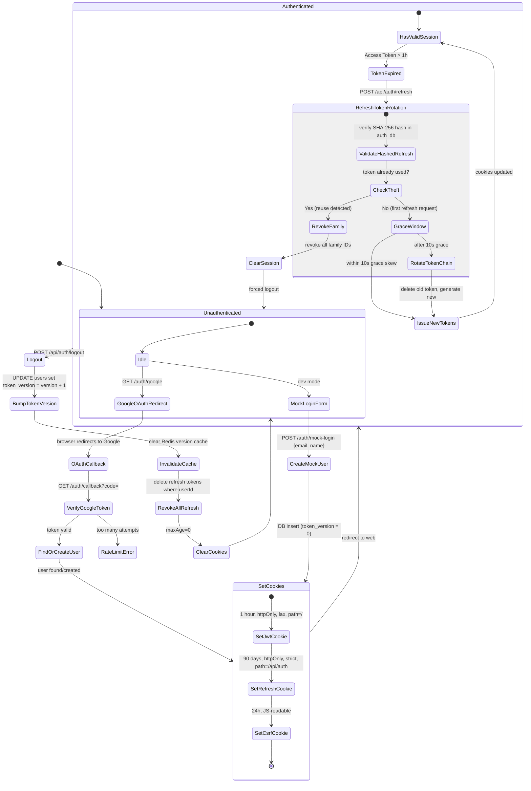
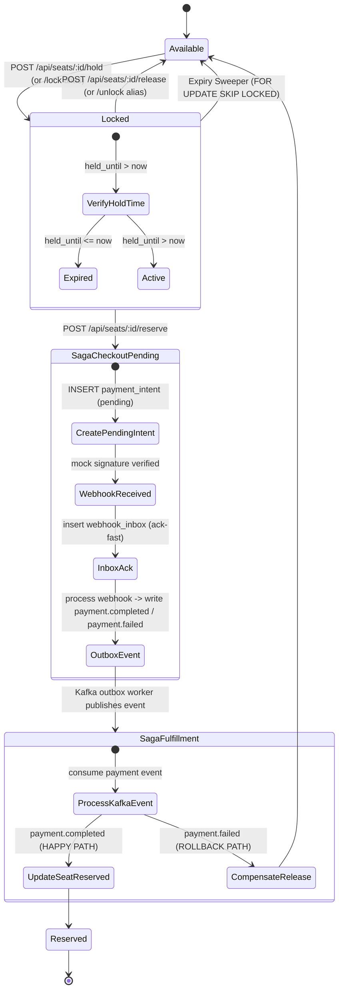
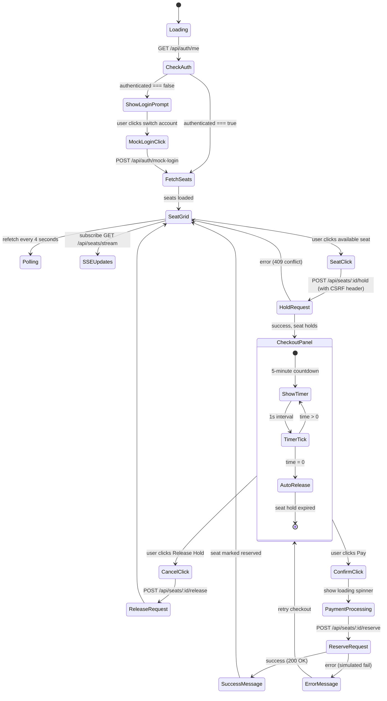
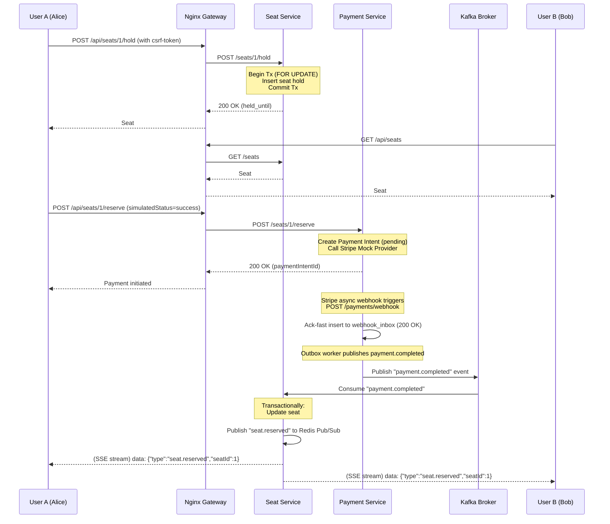
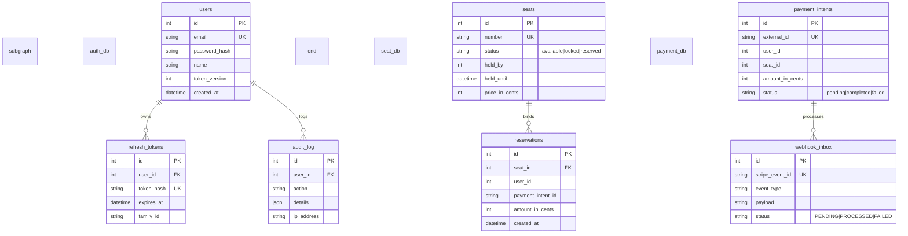

# Seat Reservation — State Machines
This guide provides visual state machines, sequence diagrams, and ER diagrams for the authentication, seat holds, checkout, and saga compensation flows.

## 1. Authentication Lifecycle
### State Machine

## 2. Distributed Seat Lifecycle & Sagas
### State Machine
The seat state is managed in `seat_db`, updated transactionally via local holds and asynchronous Kafka events:

## 3. Frontend UI State Workflow

## 4. Concurrency Sequence Diagram (Happy Path)

## 5. Partitioned Database Schema

## 6. Key Constants
| Constant | Value | Purpose |
|---|---|---|
| JWT Access Expiry | 1 hour (`3600s`) | Token lifetime |
| Refresh Token Expiry | 90 days (`7776000s`) | Persistence session lifetime |
| Token Grace Window | 10 seconds | Rotation reconnect tolerance |
| Seat Hold TTL | 5 minutes (`300s`) | Temporary booking hold limit |
| SSE Heartbeat | 30 seconds | SSE stream keep-alive pulse |
| CSRF Expiry | 24 hours | CSRF cookie lifespan |
| Seat Poll Interval | 4 seconds | Fallback seat refetch timing |
| Auth Rate Limit | 10 req/minute per IP | Throttling zone on Gateway |
| Payment Rate Limit | 15 req/minute per IP | Throttling zone on Gateway |
| General Rate Limit | 10 req/second per IP | Throttling zone on Gateway |
| Webhook Clock Skew | 5 minutes (`300s`) | Maximum webhook timestamp drift |

## 7. Error Codes
| Error Code | HTTP Status | Meaning |
|---|---|---|
| `RATE_LIMIT_EXCEEDED` | `429 Too Many Requests` | IP rate limit exceeded |
| `UNAUTHORIZED` | `401 Unauthorized` | Invalid cookie token, CSRF header, or expired session |
| `SEAT_UNAVAILABLE` | `409 Conflict` | Target seat is already held or reserved by another client |
| `EMAIL_EXISTS` | `409 Conflict` | Registration email already exists |
| `BAD_REQUEST` | `400 Bad Request` | Validation parameters, clock mismatch, or user does not own hold |
| `INTERNAL_SERVER_ERROR` | `500 Internal Server Error` | Database or outbox worker failure |
