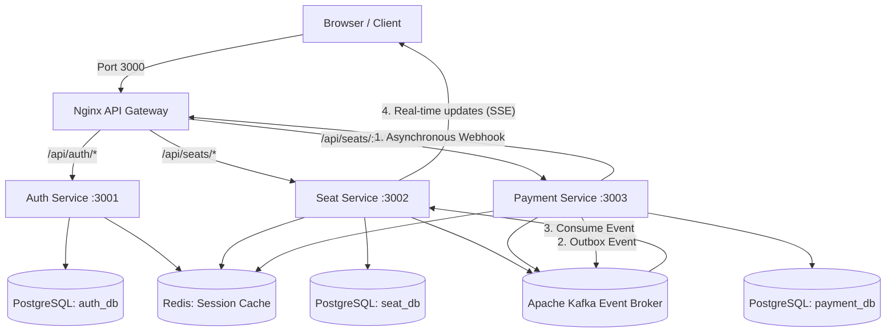

# bed-stack — Seat Reservation
A distributed, production-grade seat reservation platform built using the BED Stack (Bun + Elysia.js + Drizzle ORM) in a microservices architecture.

The system allows multiple concurrent users to browse, lock (hold), and reserve venue seats with robust concurrency controls, asynchronous payments, saga transaction coordination, and real-time updates.

## Distributed Microservices Architecture
The platform has been transformed from a monolith into three isolated, independently-scalable microservices:


### Services & Ports
* Nginx API Gateway (Port `3000`): Acts as a single reverse proxy. Routes and rewrites `/api/auth/*` to `auth-service`, `/api/seats/*` to `seat-service` (including holds and SSE streams), and `/api/seats/:id/reserve` to `payment-service`. Handles rate-limiting zones per IP.
* Web Frontend (Port `4097`): A React SPA styled with Tailwind CSS, built via Rsbuild and served via Nginx.
* Auth Service (Port `3001`): Identifies users and tracks sessions. Features Argon2id password hashing, JWT Access Tokens, opaque Refresh Token families, and immediate session invalidation via Redis version caching.
* Seat Service (Port `3002`): Bounded inventory context. Manages seat states, pessimistic locks (`SELECT FOR UPDATE`), hold sweeps, and publishes real-time seat update streams over SSE.
* Payment Service (Port `3003`): Handles billing. Interfaces with Stripe (simulated) using secure webhook HMAC verification, inbox idempotency checks, and the transactional outbox publishing pattern.
### Shared Infrastructure
* PostgreSQL 15: Separate relational databases (`auth_db`, `seat_db`, `payment_db`) running on a shared Postgres cluster.
* Redis: Rate limiting data store, SSE Redis Pub/Sub, and Access Token invalidation version cache.
* Apache Kafka: Inter-service event broker coordinating saga completions and compensations asynchronously.

## Monorepo Folder Tree
```text
seat-reservation/
├─apps/ # Microservices
│   ├─auth-service/ # Identity & Access Management (Port 3001)
│   ├─seat-service/ # Seat Inventory & Locking (Port 3002)
│   └─payment-service/ # Billing & Stripe Webhook (Port 3003)
├─packages/ # Shared Monorepo Packages
│   ├─be-core/ # Shared backend utilities (pool, logger, rate-limiter, outbox)
│   ├─contracts/ # Shared event schemas & contracts
│   └─web/ # React frontend SPA (Port 4097)
├─migrations/ # Database-specific SQL migrations (auth, seat, payment)
├─infra/ # Environment & Gateway configuration
│   ├─nginx/ # Gateway config & rate-limiting zones
│   └─postgres/ # DB initialization scripts
├─scripts/ # Shell automation & integration testing
└─docker-compose.yml # Orchestrates the local cluster
```
## Docs
| File | What it covers |
|---|---|
| [docs/features.md](./docs/features.md) | Feature specification, bounded context services, Kafka messaging, and system flow. |
| [docs/system-flows.md](./docs/system-flows.md) | UML sequence diagrams of authentication, token refresh rotation, seat hold, and saga checkout/compensation flows. |
| [docs/deployment.md](./docs/deployment.md) | System requirements, configuration parameters, and production deployment guidelines. |
| [docs/database.md](./docs/database.md) | Database schemas (`auth_db`, `seat_db`, `payment_db`), pool configurations, outbox/inbox tables, and concurrency controls. |
| [docs/development.md](./docs/development.md) | Local workspace setup, Docker Compose orchestrations, migration executions, and manual verification instructions. |
| [docs/security-review.md](./docs/security-review.md) | Complete security review details (findings and resolution checklist). |
| [docs/docker.md](./docs/docker.md) | Multi-stage service container setup, health check endpoints, and Compose cluster instructions. |
| [docs/openapi.md](./docs/openapi.md) | Complete API schemas, HTTP statuses, and gateway route specs. |
| [docs/test-plan.md](./docs/test-plan.md) | Test strategy, unit test coverage, E2E saga verification steps, and manual matrix testing. |
| [docs/validation.md](./docs/validation.md) | Strict TypeBox schemas, boundary inputs, and shared envelope contracts. |

## Core Features
- [x] Microservices separation: Auth, Seats, and Payment run in independent containerized services.
- [x] Rate Limiting Zones: Throttle login bruteforcing, payment carding, and general API floods at Nginx Gateway.
- [x] Pessimistic Locking: `SELECT FOR UPDATE` prevents double-hold race conditions.
- [x] Saga Compensations: Kafka messages trigger seat releases automatically if a payment fails.
- [x] Opaque Refresh Rotation: Refresh tokens rotate on use; reuse invalidates families immediately.
- [x] Instant Access Token Invalidation: Logout bumps version number and invalidates active JWTs across services via Redis cache.
- [x] Timing-Safe Webhooks: Webhook signatures are computed and compared using `crypto.timingSafeEqual` with timestamp age tolerance checks.
- [x] Double-Submit CSRF Pattern: Protects mutating endpoints (hold, release, reserve, logout).
- [x] Real-time Seat Updates: Live seat grid changes pushed via Server-Sent Events (SSE).

## Quick Start
### 1. Configure the Environment
You can automatically copy the template `.env.example` configurations to `.env` for the root and all microservices using the setup command:
```bash
bun env:setup
```

Alternatively, you can manually copy the templates for each service:
```bash
cp .env.example .env
cp apps/auth-service/.env.example apps/auth-service/.env
cp apps/seat-service/.env.example apps/seat-service/.env
cp apps/payment-service/.env.example apps/payment-service/.env
cp packages/web/.env.example packages/web/.env
```
### 2. Start the Services
You can run the application in two ways:
#### Option A: Fully Containerized
Build and spin up the entire cluster (Nginx, Postgres, Redis, Kafka, Web, and all services) inside Docker:
```bash
docker-compose up --build -d
```
#### Option B: Hybrid Local Development (Fast Rebuilds)
Spin up the database, cache, and broker infrastructure in the background, and run the services and web app locally via Bun:
```bash
# 1. Start Docker infrastructure
docker-compose up -d postgres redis kafka

# 2. Run local services & web app concurrently
bun d
```

Access the application at <http://localhost:4097>
### 3. Run Database Migrations
Run the migration script to apply database schemas and seed the initial seats database table:
```bash
./scripts/run-migrations.sh
```

The application is now accessible at:
* React Web Application: [http://localhost:4097](http://localhost:4097)
* API Gateway URL: [http://localhost:3000/api](http://localhost:3000/api)

## Testing
### Automated E2E Smoke Integration Test
To execute a full integration run (Registering a user, holding a seat, verifying Kafka Saga completion on successful payment, and checking Saga compensation/release on failed payment):
```bash
./scripts/smoke-test.sh
```
### Workspace Unit Tests
To run unit and component test suites (such as CSRF classes, rate limiters, validation schemas, and React components):
```bash
# Run backend package tests
bun run --cwd packages/api test

# Run frontend React component tests
bun run --cwd packages/web test
```

## Development
To run services locally outside of Docker for debugging/profiling:

```bash
# 1. Spin up only database, cache, and broker containers:
docker-compose up -d postgres redis kafka

# 2. Run your target service locally in watch mode:
bun run --cwd apps/auth-service dev # http://localhost:3001
bun run --cwd apps/seat-service dev # http://localhost:3002
bun run --cwd apps/payment-service dev # http://localhost:3003
bun run --cwd packages/web dev # http://localhost:4097
```
### Code Formatting & Linting
Enforce code style standards (using Biome):
```bash
bun run fmt
bun run lint
```
