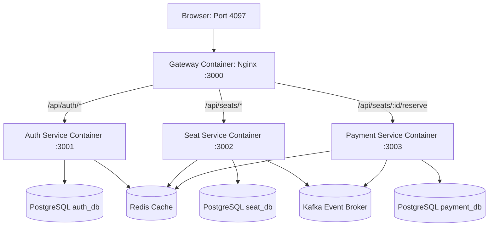

# Distributed Seat Reservation System — Docker & Compose Deployment
This document describes how to build, run, and test the seat reservation microservices system using containerized environments.

## 1. Prerequisites
Ensure you have the following installed locally:
- Docker Engine (v20.10.0 or higher)
- Docker Compose (v2.0.0 or higher)

## 2. Distributed Container Architecture
The `docker-compose.yml` configures a complete local stack consisting of 8 connected services:


### Components
1. `gateway`: An Nginx container (port `3000`) implementing reverse-proxy routing and rate-limiting zones.
2. `web`: Serves the frontend React static assets compiled by Rsbuild via an Nginx server (port `4097`).
3. `auth-service`: Handles session logins and registrations on Bun (port `3001`).
4. `seat-service`: Manages seat holds and real-time streams on Bun (port `3002`).
5. `payment-service`: Resolves Stripe-compatible webhooks on Bun (port `3003`).
6. `postgres`: Runs a PostgreSQL engine hosting three isolated databases (`auth_db`, `seat_db`, `payment_db`).
7. `redis`: Coordinates rate limits and session caching.
8. `kafka`: Apache Kafka message broker running in ZooKeeper-less Kraft mode.

## 3. Orchestration Workflow
### 1. Build and Run the Stack
From the project root:
```bash
docker-compose up --build -d
```
This builds each service's multi-stage Dockerfile, installs production dependencies, compiles frontend static assets, and starts the container cluster.
### 2. Verify Health
Verify that all containers are running and healthy:
```bash
docker-compose ps
```
All containers should display a state of `Up (healthy)`.
### 3. Run Database Migrations
Run the migration runner locally (which talks to the exposed Postgres port `5432`):
```bash
./scripts/run-migrations.sh
```
### 4. Viewing Logs
To tail logs from the entire cluster:
```bash
docker-compose logs -f
```
To tail logs from a specific microservice:
```bash
docker-compose logs -f seat-service
docker-compose logs -f payment-service
```
### 5. Stopping and Resetting
To stop the services while preserving database records:
```bash
docker-compose stop
```
To tear down the containers and delete all persistent volumes (this resets all database schemas and Redis caches):
```bash
docker-compose down -v
```
Upon next `docker-compose up --build -d`, a fresh database will be initialized.
