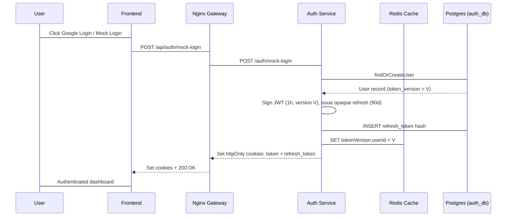
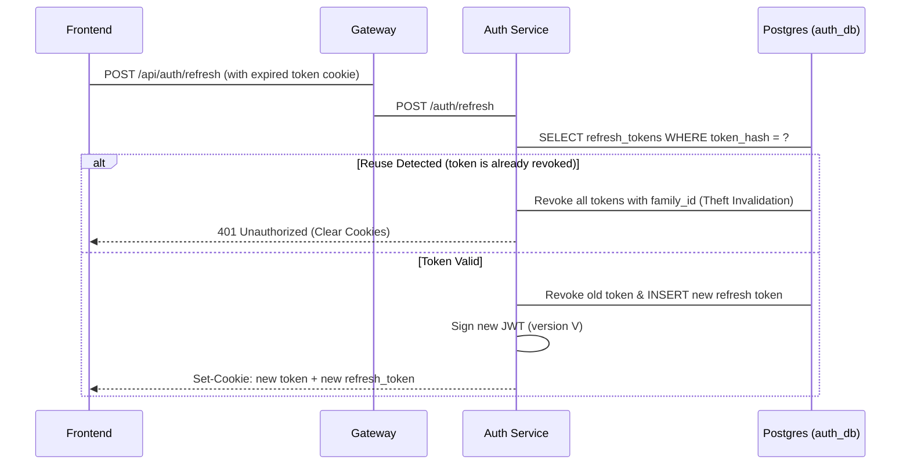
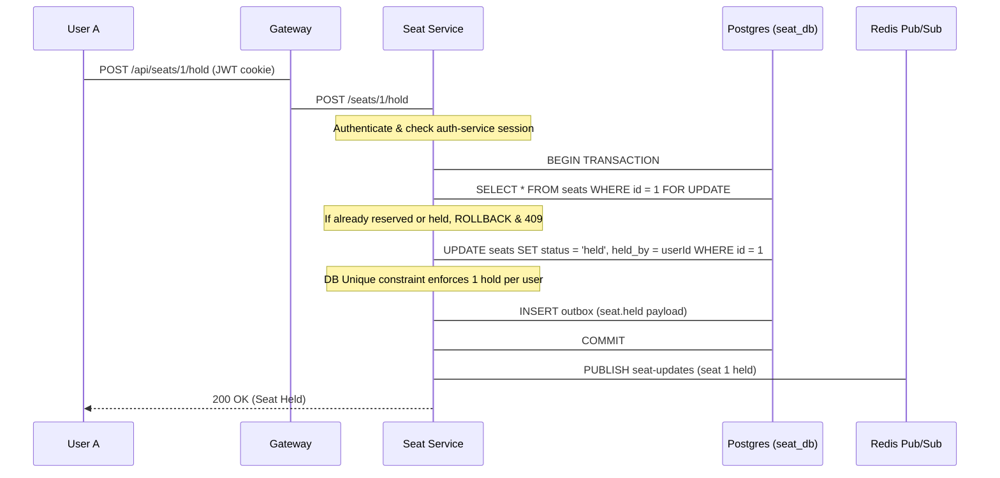
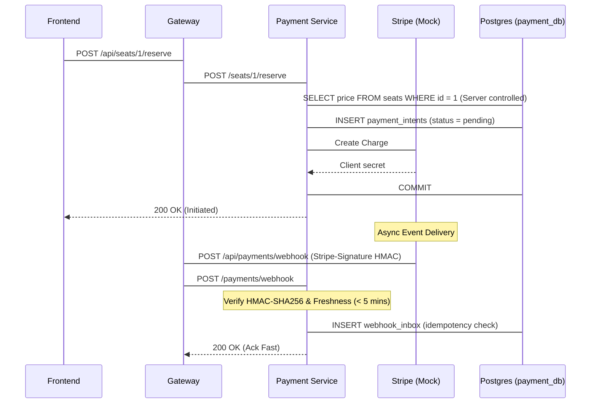
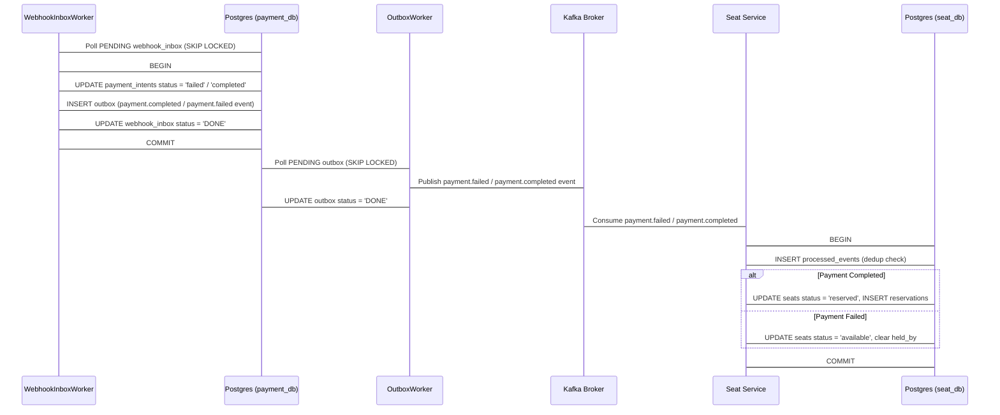

# Distributed Seat Reservation System — UML Flows & Architectures
## 1. Authentication Flow (OAuth + JWT + Redis Cache)
The client requests authenticate at the Nginx Gateway, which proxies to `auth-service`. Access Token validation uses a Redis-backed version lookup to allow immediate logout invalidation.



## 2. Token Refresh Rotation & Theft Detection
On token refresh, the old token is rotated. If reuse is detected, the family is invalidated. A 10-second grace window prevents mobile retry storms from breaking sessions.



## 3. Seat Hold Concurrency Flow (Pessimistic Locking)
Pessimistic row locking ensures only one user holds a seat. Unique constraints enforce the "one hold per user" rule.



## 4. Webhook Inbox & Transactional Outbox (Reserve Flow)
Ensures reliable transactional operations. Creating checkout creates a payment intent, which triggers simulated webhook delivery.



## 5. Saga Compensation Flow (Payment Failed / Succeeded)
The Payment worker processes the inbox asynchronously and publishes events to Kafka. The Seat service consumes events to reserve the seat or compensate by releasing holds.



## 6. Gateway Request Pipeline
Nginx filters and routes all inbound traffic.

```mermaid
graph TB
    subgraph Client Layer
        FE[React SPA]
    end

    subgraph Gateway Layer (Nginx :3000)
        GW[Nginx Gateway]
        Rate[Rate Limiting Zone: auth/payment/general]
        Route{Match Path}
    end

    subgraph Service Mesh
        Auth[Auth Service :3001]
        Seats[Seat Service :3002]
        Pay[Payment Service :3003]
    end

    subgraph Datastores
        DB1[(auth_db)]
        DB2[(seat_db)]
        DB3[(payment_db)]
        Redis[(Redis Cache)]
        Kafka[(Kafka Broker)]
    end

    FE -->|HTTP request| GW
    GW --> Rate
    Rate --> Route
    Route -->|/api/auth/*| Auth
    Route -->|/api/seats/*| Seats
    Route -->|/api/seats/:id/reserve| Pay
    
    Auth --> DB1
    Auth --> Redis
    
    Seats --> DB2
    Seats --> Redis
    
    Pay --> DB3
    Pay --> Redis
    Pay --> Kafka
    Kafka -.->|Event Saga| Seats
```
